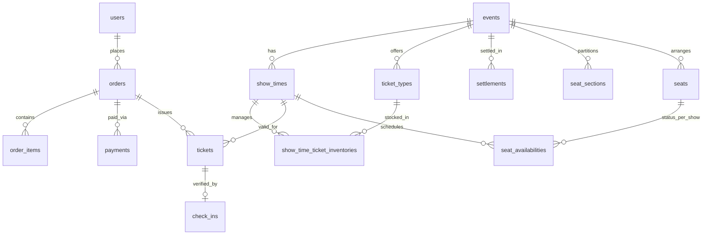

# Tikzy — Sơ đồ & Thiết kế Cơ sở Dữ liệu (Database Schema)

> **Cơ sở dữ liệu**: PostgreSQL / Supabase  
> **Nguồn migration**: Flyway `V1` → `V16`  
> **Khóa chính (Primary Key)**: Toàn bộ bảng sử dụng kiểu `UUID` (`gen_random_uuid()`).  
> **Công cụ trực quan hóa**: Hỗ trợ copy mã DBML ở [Mục 5](#5-mã-nguồn-dbml-cho-dbdiagramio) và dán trực tiếp vào [dbdiagram.io](https://dbdiagram.io/d).

---

## Mục lục

1. [Tổng quan phân nhóm nghiệp vụ](#1-tổng-quan-phân-nhóm-nghiệp-vụ)
2. [Danh sách Enums](#2-danh-sách-enums)
3. [Chi tiết các bảng theo phân hệ nghiệp vụ](#3-chi-tiết-các-bảng-theo-phân-hệ-nghiệp-vụ)
   - [3.1 Auth & RBAC](#31-auth--rbac)
   - [3.2 Event Module](#32-event-module)
   - [3.3 Advertisement Module](#33-advertisement-module)
   - [3.4 Promotion Module](#34-promotion-module)
   - [3.5 Order Module](#35-order-module)
   - [3.6 Payment & Refund Module](#36-payment--refund-module)
   - [3.7 Broadcast Module](#37-broadcast-module)
   - [3.8 Settlement Module (Escrow)](#38-settlement-module-escrow)
   - [3.9 Ticket & Check-in Module](#39-ticket--check-in-module)
   - [3.10 Seating Module (ASSIGNED_SEAT)](#310-seating-module-assigned_seat)
4. [Bảng quan hệ giữa các thực thể (Relationships)](#4-bảng-quan-hệ-giữa-các-thực-thể-relationships)
5. [Mã nguồn DBML cho dbdiagram.io](#5-mã-nguồn-dbml-cho-dbdiagramio)

---

## 1. Tổng quan phân nhóm nghiệp vụ

| Phân nhóm | Mô tả | Các bảng chính |
| :--- | :--- | :--- |
| **Auth & RBAC** | Quản lý người dùng, phân quyền, token, chính sách bảo mật, duyệt organizer | `roles`, `users`, `refresh_tokens`, `security_policies`, `account_unlock_requests`, `email_templates`, `organizer_applications` |
| **Event** | Quản lý sự kiện, danh mục, suất diễn, hạng vé và tồn kho vé | `categories`, `category_requests`, `events`, `show_times`, `ticket_types`, `show_time_ticket_inventories` |
| **Advertisement** | Gói quảng cáo banner, chiến dịch quảng cáo cho organizer | `ad_packages`, `ad_campaigns`, `banners` |
| **Promotion** | Quản lý mã giảm giá (voucher), cấp phát và lịch sử sử dụng | `promotions`, `user_promotions`, `promotion_usages` |
| **Order** | Quản lý đơn hàng mua vé và chi tiết đơn hàng | `orders`, `order_items` |
| **Payment & Refund** | Tích hợp cổng thanh toán (VNPAY, MoMo, ZaloPay), hoàn tiền | `payments`, `refund_logs` |
| **Broadcast** | Gửi thông báo đại chúng từ Organizer đến người tham gia | `event_broadcasts` |
| **Settlement** | Quyết toán doanh thu bán vé, giữ tiền (escrow), trừ phí nền tảng | `settlements` |
| **Ticket & Check-in** | Cấp phát vé số (HMAC-SHA256 QR), check-in tại cổng, phân công staff | `tickets`, `check_ins`, `event_staffs` |
| **Seating** | Quản lý sơ đồ ghế ngồi (khu vực, số ghế, trạng thái giữ chỗ/bán) | `seat_sections`, `seats`, `seat_availabilities` |

---

## 2. Danh sách Enums

*Lưu ý: Các Enum thực tế trong PostgreSQL được lưu dưới dạng `VARCHAR` với ràng buộc `CHECK`.*

- **`OrganizerType`**: `INDIVIDUAL`, `BUSINESS`
- **`ReviewStatus`**: `PENDING`, `APPROVED`, `REJECTED`
- **`CategoryStatus`**: `DRAFT`, `PUBLISHED`, `ARCHIVED`
- **`AccountRecoveryType`**: `ACCOUNT_UNLOCK`, `PASSWORD_RESET`
- **`EventStatus`**: `DRAFT`, `PENDING`, `APPROVED`, `PUBLISHED`, `CANCELLED`, `ENDED`
- **`RefundPolicy`**: `NO_REFUND`, `ALLOW_REFUND`
- **`PlacementType`**: `HOME_HERO_SLIDER`, `CATEGORY_TOP`, `BADGE_HOT`
- **`BannerPosition`**: `HOME_HERO_SLIDER`, `HOME_SUB_BANNER`, `EVENT_SIDEBAR`
- **`BillingType`**: `PREPAID`, `POSTPAID_ESCROW`
- **`PaymentGateway`**: `VNPAY`, `MOMO`, `ZALOPAY`
- **`AdPaymentMethod`**: `VNPAY`, `MOMO`, `DEDUCT_ESCROW`
- **`AdPaymentStatus`**: `UNPAID`, `PAID`, `WAITING_SETTLEMENT`, `SETTLED`, `CANCELLED`, `REFUNDED`
- **`CampaignStatus`**: `PENDING_APPROVAL`, `APPROVED`, `RUNNING`, `COMPLETED`, `REJECTED`
- **`DiscountType`**: `PERCENTAGE`, `FIXED_AMOUNT`
- **`UserPromotionStatus`**: `AVAILABLE`, `USED`, `EXPIRED`, `REVOKED`
- **`PromotionUsageStatus`**: `RESERVED`, `COMPLETED`, `RELEASED`
- **`OrderStatus`**: `PENDING`, `PAID`, `CANCELLED`, `REFUNDED`, `EXPIRED`
- **`PaymentStatus`**: `PENDING`, `SUCCESS`, `FAILED`, `CANCELLED`, `REFUNDED`
- **`RefundStatus`**: `PROCESSING`, `SUCCESS`, `FAILED`, `MANUAL_BANK`
- **`TargetAudience`**: `ALL_ATTENDEES`, `VOUCHER_USERS_ONLY`
- **`SettlementStatus`**: `PENDING`, `APPROVED`, `PAID`, `CANCELLED`
- **`TicketStatus`**: `SOLD`, `USED`, `CANCELLED`
- **`CheckInMethod`**: `QR_SCAN`, `MANUAL`
- **`SeatingMode`**: `GENERAL_ADMISSION`, `ASSIGNED_SEAT`
- **`SeatAvailabilityStatus`**: `AVAILABLE`, `HELD`, `SOLD`, `BLOCKED`

---

## 3. Chi tiết các bảng theo phân hệ nghiệp vụ

### 3.1 Auth & RBAC
- **`roles`**: Danh mục vai trò (`ROLE_ATTENDEE`, `ROLE_ORGANIZER`, `ROLE_STAFF`, `ROLE_ADMIN`).
- **`users`**: Tài khoản người dùng, lưu mật khẩu hash, token version (để vô hiệu hóa token khi logout-all), trạng thái khóa tài khoản (`is_locked`, `failed_login_attempts`), người tạo (`created_by` cho tài khoản staff).
- **`refresh_tokens`**: Quản lý phiên đăng nhập và refresh token, lưu kèm `device_info`, `ip_address`, thời hạn hết hạn.
- **`security_policies`**: Cấu hình động cho chính sách bảo mật (ngưỡng đăng nhập sai `max_failed_login_attempts`).
- **`account_unlock_requests`**: Yêu cầu mở khóa tài khoản hoặc đặt lại mật khẩu bằng OTP / reset token.
- **`email_templates`**: Mẫu email động (HTML/Text) cho các nghiệp vụ xác thực và thông báo.
- **`organizer_applications`**: Đơn đăng ký trở thành Ban tổ chức (Organizer) của cá nhân/doanh nghiệp kèm quy trình phê duyệt.

### 3.2 Event Module
- **`categories`**: Danh mục sự kiện hỗ trợ slug, icon Cloudinary, `normalized_name` chống trùng tên danh mục.
- **`category_requests`**: Đề xuất tạo thêm danh mục từ phía Organizer kèm quy trình xét duyệt của Admin.
- **`events`**: Thông tin sự kiện (tiêu đề, địa điểm, banner/thumbnail, chính sách hoàn tiền, chế độ ghế `seating_mode`).
- **`show_times`**: Các suất diễn của sự kiện (thời gian bắt đầu, kết thúc).
- **`ticket_types`**: Các hạng vé cho sự kiện (Early Bird, Standard, VIP, VVIP) kèm giá vé và giới hạn số vé mỗi đơn.
- **`show_time_ticket_inventories`**: Tồn kho vé độc lập theo từng cặp `(show_time_id, ticket_type_id)` gồm `total_quantity`, `reserved_quantity`, `sold_quantity`.

### 3.3 Advertisement Module
- **`ad_packages`**: Các gói quảng cáo cố định theo vị trí và số ngày hiển thị.
- **`ad_campaigns`**: Chiến dịch quảng cáo do Organizer đăng ký cho sự kiện của họ (hình thức thanh toán trả trước hoặc cấn trừ quyết toán).
- **`banners`**: Hình ảnh banner hiển thị trên trang chủ/sidebar kèm đường dẫn mục tiêu.

### 3.4 Promotion Module
- **`promotions`**: Mã giảm giá/voucher (toàn sàn hoặc theo sự kiện), hỗ trợ giảm theo % hoặc số tiền cố định, voucher bồi thường khi hủy show.
- **`user_promotions`**: Quản lý ví voucher của từng người dùng.
- **`promotion_usages`**: Lịch sử sử dụng voucher theo từng đơn hàng (trạng thái `RESERVED` khi tạo đơn và `COMPLETED` khi thanh toán thành công).

### 3.5 Order Module
- **`orders`**: Đơn đặt vé với mã đơn `TKZ-YYYYMMDD-XXXXX`, thời gian hết hạn giữ chỗ (15 phút), tổng tiền gốc, giảm giá, và thực trả.
- **`order_items`**: Chi tiết từng hạng vé và số lượng vé trong đơn hàng.

### 3.6 Payment & Refund Module
- **`payments`**: Giao dịch thanh toán qua cổng điện tử (VNPAY, MoMo, ZaloPay), cho phép thử lại nhiều cổng trong hạn 15 phút.
- **`refund_logs`**: Nhật ký hoàn tiền (tự động qua cổng hoặc thủ công qua chuyển khoản ngân hàng) kèm `idempotency_key` chống hoàn tiền trùng.

### 3.7 Broadcast Module
- **`event_broadcasts`**: Kênh gửi thông báo từ Organizer đến người tham gia (tất cả hoặc chỉ nhóm dùng voucher), hỗ trợ đính kèm voucher đền bù.

### 3.8 Settlement Module (Escrow)
- **`settlements`**: Bảng quyết toán tiền bán vé cho Organizer sau sự kiện (Gross revenue - Refund - Phí sàn - Phí quảng cáo = Payout amount).

### 3.9 Ticket & Check-in Module
- **`tickets`**: Vé điện tử được phát hành sau khi thanh toán thành công, chứa chuỗi `qr_payload` (ký số HMAC-SHA256) và thông tin vị trí ghế.
- **`check_ins`**: Lịch sử quét mã QR vào cổng, có ràng buộc UNIQUE trên `ticket_id` để ngăn check-in hai lần.
- **`event_staffs`**: Danh sách nhân viên (Role Staff) được phân công trực tiếp vào từng sự kiện để quét vé.

### 3.10 Seating Module (ASSIGNED_SEAT)
- **`seat_sections`**: Phân khu ghế (Khu A, VIP, Khán đài).
- **`seats`**: Tọa độ và vị trí từng ghế (`row_label`, `seat_number`, tọa độ `position_x`, `position_y`).
- **`seat_availabilities`**: Trạng thái khả dụng của ghế theo từng suất diễn (`AVAILABLE`, `HELD`, `SOLD`, `BLOCKED`) kèm hạn giữ chỗ `held_until`.

---

## 4. Bảng quan hệ giữa các thực thể (Relationships)



---

## 5. Mã nguồn DBML cho dbdiagram.io

Bạn có thể copy toàn bộ đoạn mã bên dưới và dán vào [dbdiagram.io](https://dbdiagram.io/d) để tự động sinh biểu đồ ERD:

```dbml
// =====================================================================
// TIKZY — SƠ ĐỒ DATABASE (PostgreSQL / Supabase)
// Nguồn dữ liệu: backend/src/main/resources/db/migration (Flyway V1 → V16)
// Cách dùng: mở https://dbdiagram.io/d → Import → dán toàn bộ file này
// Lưu ý: các Enum bên dưới thực tế được lưu dạng VARCHAR trong PostgreSQL
//        (ràng buộc giá trị nằm ở CHECK constraint hoặc tầng ứng dụng).
// =====================================================================

Project tikzy_db {
  database_type: 'PostgreSQL'
  Note: '''
  # Tikzy — Nền tảng bán vé sự kiện
  Schema cuối cùng sau khi hợp nhất toàn bộ migration V1 → V16.
  Toàn bộ khóa chính dùng UUID (gen_random_uuid()).

  ## Phân nhóm nghiệp vụ
  - **Auth & RBAC**: roles, users, refresh_tokens, security_policies,
    account_unlock_requests, email_templates, organizer_applications
  - **Event**: categories, category_requests, events, show_times, ticket_types,
    show_time_ticket_inventories
  - **Advertisement**: ad_packages, ad_campaigns, banners
  - **Promotion**: promotions, user_promotions, promotion_usages
  - **Order / Payment**: orders, order_items, payments, refund_logs
  - **Ticket & Check-in**: tickets, check_ins, event_staffs
  - **Broadcast**: event_broadcasts
  - **Settlement (escrow)**: settlements
  - **Seating (ASSIGNED_SEAT)**: seat_sections, seats, seat_availabilities
  '''
}

// =====================================================================
// ENUMS (giá trị hợp lệ của các cột trạng thái)
// =====================================================================

enum OrganizerType {
  INDIVIDUAL
  BUSINESS
}

enum ReviewStatus {
  PENDING
  APPROVED
  REJECTED
}

enum CategoryStatus {
  DRAFT
  PUBLISHED
  ARCHIVED
}

enum AccountRecoveryType {
  ACCOUNT_UNLOCK
  PASSWORD_RESET
}

enum EventStatus {
  DRAFT
  PENDING
  APPROVED
  PUBLISHED
  CANCELLED
  ENDED
}

enum RefundPolicy {
  NO_REFUND
  ALLOW_REFUND
}

enum PlacementType {
  HOME_HERO_SLIDER
  CATEGORY_TOP
  BADGE_HOT
}

enum BannerPosition {
  HOME_HERO_SLIDER
  HOME_SUB_BANNER
  EVENT_SIDEBAR
}

enum BillingType {
  PREPAID
  POSTPAID_ESCROW
}

enum PaymentGateway {
  VNPAY
  MOMO
  ZALOPAY
}

enum AdPaymentMethod {
  VNPAY
  MOMO
  DEDUCT_ESCROW
}

enum AdPaymentStatus {
  UNPAID
  PAID
  WAITING_SETTLEMENT
  SETTLED
  CANCELLED
  REFUNDED
}

enum CampaignStatus {
  PENDING_APPROVAL
  APPROVED
  RUNNING
  COMPLETED
  REJECTED
}

enum DiscountType {
  PERCENTAGE
  FIXED_AMOUNT
}

enum UserPromotionStatus {
  AVAILABLE
  USED
  EXPIRED
  REVOKED
}

enum PromotionUsageStatus {
  RESERVED
  COMPLETED
  RELEASED
}

enum OrderStatus {
  PENDING
  PAID
  CANCELLED
  REFUNDED
  EXPIRED
}

enum PaymentStatus {
  PENDING
  SUCCESS
  FAILED
  CANCELLED
  REFUNDED
}

enum RefundStatus {
  PROCESSING
  SUCCESS
  FAILED
  MANUAL_BANK
}

enum TargetAudience {
  ALL_ATTENDEES
  VOUCHER_USERS_ONLY
}

enum SettlementStatus {
  PENDING
  APPROVED
  PAID
  CANCELLED
}

enum TicketStatus {
  SOLD
  USED
  CANCELLED
}

enum CheckInMethod {
  QR_SCAN
  MANUAL
}

enum SeatingMode {
  GENERAL_ADMISSION
  ASSIGNED_SEAT
}

enum SeatAvailabilityStatus {
  AVAILABLE
  HELD
  SOLD
  BLOCKED
}

// =====================================================================
// AUTH & RBAC
// =====================================================================

Table roles {
  id uuid [pk]
  code varchar(50) [not null, unique, note: 'ROLE_ATTENDEE | ROLE_ORGANIZER | ROLE_STAFF | ROLE_ADMIN']
  name varchar(100) [not null]
  description varchar(255)
  created_at timestamp [not null, default: `now()`]
}

Table users {
  id uuid [pk]
  role_id uuid [not null]
  email varchar(255) [not null, unique]
  phone varchar(20) [unique]
  password_hash varchar(255) [not null]
  full_name varchar(255) [not null]
  avatar_url varchar(500) [note: 'Cloudinary']
  is_active boolean [not null, default: true]
  token_version integer [not null, default: 0, note: 'V4 — tăng khi logout-all, vô hiệu access token cũ']
  failed_login_attempts integer [not null, default: 0, note: 'V6']
  is_locked boolean [not null, default: false, note: 'V6']
  locked_at timestamp [note: 'V6']
  created_by uuid [note: 'V16 — organizer tạo tài khoản staff; NULL nếu user tự đăng ký']
  must_change_password boolean [not null, default: false, note: 'V16 — true khi đang dùng mật khẩu tạm, bắt buộc đổi ở lần đăng nhập đầu']
  created_at timestamp [not null, default: `now()`]

  indexes {
    created_by [note: 'partial: WHERE created_by IS NOT NULL']
  }

  Note: 'CHECK: failed_login_attempts >= 0'
}

Table refresh_tokens {
  id uuid [pk]
  user_id uuid [not null]
  token varchar(512) [not null, unique]
  device_info varchar(500)
  ip_address varchar(45)
  expires_at timestamp [not null]
  is_revoked boolean [not null, default: false]
  created_at timestamp [not null, default: `now()`]
  updated_at timestamp [not null, default: `now()`]

  indexes {
    user_id
  }
}

Table security_policies {
  id uuid [pk]
  max_failed_login_attempts integer [not null, default: 5, note: 'CHECK > 0']
  created_at timestamp [not null, default: `now()`]
  updated_at timestamp [not null, default: `now()`]

  Note: 'Cấu hình động cho chính sách khóa đăng nhập (V6).'
}

Table account_unlock_requests {
  id uuid [pk]
  user_id uuid [not null]
  otp_hash varchar(255) [not null]
  otp_attempts integer [not null, default: 0, note: 'CHECK >= 0']
  otp_expires_at timestamp [not null]
  reset_token_hash varchar(64) [unique]
  reset_token_expires_at timestamp
  otp_verified_at timestamp
  consumed_at timestamp
  request_type AccountRecoveryType [not null, default: 'ACCOUNT_UNLOCK', note: 'V11 — ACCOUNT_UNLOCK | PASSWORD_RESET']
  created_at timestamp [not null, default: `now()`]
  updated_at timestamp [not null, default: `now()`]

  indexes {
    (user_id, created_at)
    (user_id, request_type, created_at)
  }
}

Table email_templates {
  id uuid [pk]
  code varchar(100) [not null, unique]
  name varchar(255) [not null]
  subject varchar(255) [not null]
  html_content text [not null]
  text_content text
  is_active boolean [not null, default: true]
  created_at timestamp [not null, default: `now()`]
  updated_at timestamp [not null, default: `now()`]
}

Table organizer_applications {
  id uuid [pk]
  applicant_id uuid [not null]
  organizer_type OrganizerType [not null, note: 'INDIVIDUAL | BUSINESS']
  organizer_name varchar(255) [not null]
  identity_number varchar(50) [note: 'bắt buộc nếu INDIVIDUAL']
  tax_code varchar(50) [note: 'bắt buộc nếu BUSINESS']
  contact_phone varchar(20) [not null]
  address varchar(500) [not null]
  website_url varchar(500)
  description text
  status ReviewStatus [not null, default: 'PENDING']
  review_note varchar(1000) [note: 'bắt buộc khi REJECTED']
  reviewed_by uuid [note: 'khác NULL khi APPROVED/REJECTED']
  reviewed_at timestamp [note: 'khác NULL khi APPROVED/REJECTED']
  created_at timestamp [not null, default: `now()`]

  indexes {
    applicant_id
    (status, created_at)
    identity_number [unique, note: 'partial: WHERE identity_number IS NOT NULL AND status IN (PENDING, APPROVED)']
    tax_code [unique, note: 'partial: WHERE tax_code IS NOT NULL AND status IN (PENDING, APPROVED)']
    applicant_id [unique, name: 'uq_organizer_applications_one_pending_per_user', note: 'partial: WHERE status = PENDING']
  }

  Note: 'CHECK ràng buộc giấy tờ theo organizer_type và trạng thái review.'
}

// =====================================================================
// EVENT MODULE
// =====================================================================

Table categories {
  id uuid [pk]
  name varchar(100) [not null]
  slug varchar(100) [not null, unique]
  icon_url varchar(500) [note: 'Cloudinary']
  sort_order integer [not null, default: 0]
  status CategoryStatus [not null, default: 'DRAFT', note: 'V13 — thay thế cột is_active']
  normalized_name varchar(100) [not null, note: 'V14 — lower + gộp khoảng trắng, dùng để chống trùng']
  created_at timestamp [not null, default: `now()`]

  indexes {
    normalized_name [unique, note: 'partial: WHERE status IN (DRAFT, PUBLISHED)']
  }
}

Table category_requests {
  id uuid [pk]
  requester_id uuid [not null]
  proposed_name varchar(100) [not null]
  normalized_proposed_name varchar(100) [not null, note: 'V14']
  description varchar(1000)
  status ReviewStatus [not null, default: 'PENDING']
  review_note varchar(1000) [note: 'bắt buộc khi REJECTED']
  reviewed_by uuid
  reviewed_at timestamp
  category_id uuid [note: 'gán khi APPROVED — trỏ tới category được tạo']
  created_at timestamp [not null, default: `now()`]

  indexes {
    (status, created_at)
    requester_id
    (normalized_proposed_name, status)
  }
}

Table events {
  id uuid [pk]
  organizer_id uuid [not null]
  category_id uuid [not null]
  title varchar(500) [not null]
  description text
  venue_name varchar(255)
  venue_address varchar(500)
  banner_url varchar(500) [note: 'Cloudinary']
  thumbnail_url varchar(500) [note: 'Cloudinary']
  status EventStatus [not null, default: 'DRAFT']
  seating_mode SeatingMode [not null, default: 'GENERAL_ADMISSION', note: 'V15 — GENERAL_ADMISSION | ASSIGNED_SEAT']
  refund_policy RefundPolicy [not null, default: 'NO_REFUND']
  refund_deadline_days integer
  refund_fee_percentage numeric(5,2)
  cancellation_reason text
  cancelled_at timestamp
  created_at timestamp [not null, default: `now()`]

  indexes {
    organizer_id
    category_id
    status
  }
}

Table show_times {
  id uuid [pk]
  event_id uuid [not null]
  start_time timestamp [not null]
  end_time timestamp [not null]
  is_active boolean [not null, default: true]
  created_at timestamp [not null, default: `now()`]

  indexes {
    event_id
  }
}

Table ticket_types {
  id uuid [pk]
  event_id uuid [not null]
  name varchar(100) [not null, note: 'GA, VIP, VVIP, Early Bird...']
  price numeric(15,2) [not null, note: 'CHECK >= 0']
  max_per_order integer [not null, default: 10]
  is_active boolean [not null, default: true]
  created_at timestamp [not null, default: `now()`]

  indexes {
    event_id
  }

  Note: 'V2 — đã bỏ total_quantity/sold_quantity; tồn kho chuyển sang show_time_ticket_inventories.'
}

Table show_time_ticket_inventories {
  id uuid [pk]
  show_time_id uuid [not null]
  ticket_type_id uuid [not null]
  total_quantity integer [not null, note: 'CHECK >= 0']
  reserved_quantity integer [not null, default: 0, note: 'CHECK >= 0']
  sold_quantity integer [not null, default: 0, note: 'CHECK >= 0']
  created_at timestamp [not null, default: `now()`]
  updated_at timestamp [not null, default: `now()`]

  indexes {
    (show_time_id, ticket_type_id) [unique, name: 'uq_inventory_show_time_ticket_type']
    show_time_id
    ticket_type_id
  }

  Note: 'V2 — tồn kho theo (suất diễn, hạng vé). CHECK: reserved + sold <= total.'
}

// =====================================================================
// ADVERTISEMENT MODULE
// =====================================================================

Table ad_packages {
  id uuid [pk]
  code varchar(50) [not null, unique, note: 'HERO_SLIDER_7D, CATEGORY_TOP_3D...']
  name varchar(255) [not null]
  description text
  price numeric(15,2) [not null]
  duration_days integer [not null]
  placement_type PlacementType [not null]
  is_active boolean [not null, default: true]
  created_at timestamp [not null, default: `now()`]
}

Table ad_campaigns {
  id uuid [pk]
  package_id uuid [not null]
  event_id uuid [not null]
  organizer_id uuid [not null]
  total_price numeric(15,2) [not null]
  billing_type BillingType [not null, note: 'PREPAID | POSTPAID_ESCROW']
  payment_method AdPaymentMethod [note: 'VNPAY | MOMO | DEDUCT_ESCROW']
  payment_status AdPaymentStatus [not null, default: 'UNPAID']
  status CampaignStatus [not null, default: 'PENDING_APPROVAL']
  start_date timestamp
  end_date timestamp
  note text
  created_at timestamp [not null, default: `now()`]

  indexes {
    event_id
    organizer_id
  }
}

Table banners {
  id uuid [pk]
  ad_campaign_id uuid [note: 'NULL nếu Admin tự tạo']
  event_id uuid [note: 'NULL nếu dùng target_url ngoài']
  title varchar(255)
  image_url varchar(500) [not null, note: 'Cloudinary CDN đang hiển thị']
  pending_image_url varchar(500) [note: 'ảnh mới chờ duyệt đổi']
  target_url varchar(500)
  position BannerPosition [not null]
  sort_order integer [not null, default: 0]
  start_date timestamp
  end_date timestamp
  is_active boolean [not null, default: true]
  created_at timestamp [not null, default: `now()`]

  indexes {
    (position, is_active)
  }
}

// =====================================================================
// PROMOTION MODULE
// =====================================================================

Table promotions {
  id uuid [pk]
  event_id uuid [note: 'NULL = áp dụng toàn sàn']
  organizer_id uuid
  code varchar(50) [not null, unique, note: 'SUMMER2026, FANLOVE25...']
  discount_type DiscountType [not null]
  discount_value numeric(15,2) [not null]
  min_order_amount numeric(15,2)
  max_discount_amount numeric(15,2)
  total_usage_limit integer
  used_count integer [not null, default: 0]
  max_usage_per_user integer [note: 'V2 — CHECK NULL hoặc > 0']
  is_compensation boolean [not null, default: false, note: 'voucher đền bù show hủy']
  valid_from timestamp
  valid_to timestamp
  is_active boolean [not null, default: true]
  created_at timestamp [not null, default: `now()`]

  indexes {
    event_id
  }
}

Table user_promotions {
  id uuid [pk]
  user_id uuid [not null]
  promotion_id uuid [not null]
  source varchar(30) [not null, note: 'V2 — nguồn phát hành voucher']
  source_broadcast_id uuid [note: 'V2 — broadcast đã phát voucher này']
  status UserPromotionStatus [not null, default: 'AVAILABLE']
  issued_at timestamp [not null, default: `now()`]
  used_at timestamp
  created_at timestamp [not null, default: `now()`]

  indexes {
    (user_id, promotion_id) [unique, name: 'uq_user_promotion']
    user_id
    promotion_id
  }
}

Table promotion_usages {
  id uuid [pk]
  promotion_id uuid [not null]
  user_id uuid [not null]
  order_id uuid [not null]
  discount_amount numeric(15,2) [not null, note: 'CHECK >= 0']
  status PromotionUsageStatus [not null, default: 'RESERVED']
  used_at timestamp
  created_at timestamp [not null, default: `now()`]

  indexes {
    order_id [unique, name: 'uq_promotion_usage_order']
    user_id
    promotion_id
  }
}

// =====================================================================
// ORDER MODULE
// =====================================================================

Table orders {
  id uuid [pk]
  order_code varchar(30) [not null, unique, note: 'TKZ-YYYYMMDD-XXXXX']
  user_id uuid [not null]
  event_id uuid [not null]
  show_time_id uuid [not null, note: 'V2 — bắt buộc, mỗi đơn thuộc 1 suất diễn']
  promotion_id uuid
  subtotal numeric(15,2) [not null, note: 'giá gốc trước giảm']
  discount_amount numeric(15,2) [not null, default: 0]
  total_amount numeric(15,2) [not null, note: 'tiền THỰC TRẢ — dùng để refund']
  status OrderStatus [not null, default: 'PENDING']
  customer_name varchar(255) [not null]
  customer_email varchar(255) [not null]
  customer_phone varchar(20)
  expires_at timestamp [not null, note: 'giữ chỗ 15 phút']
  created_at timestamp [not null, default: `now()`]

  indexes {
    user_id
    event_id
    show_time_id
    (status, expires_at)
  }
}

Table order_items {
  id uuid [pk]
  order_id uuid [not null]
  ticket_type_id uuid [not null]
  quantity integer [not null]
  unit_price numeric(15,2) [not null]
  created_at timestamp [not null, default: `now()`]

  indexes {
    order_id
  }
}

// =====================================================================
// PAYMENT & REFUND MODULE
// =====================================================================

Table payments {
  id uuid [pk]
  order_id uuid [not null, note: '1 đơn có thể thử thanh toán nhiều lần (đổi cổng trong 15 phút)']
  method PaymentGateway [not null, note: 'VNPAY | MOMO | ZALOPAY']
  transaction_id varchar(255) [note: 'mã GD từ cổng thanh toán']
  amount numeric(15,2) [not null, note: '= orders.total_amount']
  status PaymentStatus [not null, default: 'PENDING']
  paid_at timestamp
  created_at timestamp [not null, default: `now()`]

  indexes {
    order_id
    transaction_id
    (status, created_at)
    (method, transaction_id) [unique, note: 'partial: WHERE transaction_id IS NOT NULL']
    order_id [unique, name: 'uq_payments_one_settled_payment_per_order', note: 'partial: WHERE status IN (SUCCESS, REFUNDED)']
  }
}

Table refund_logs {
  id uuid [pk]
  order_id uuid [not null]
  event_id uuid [not null]
  payment_id uuid [not null, note: 'V2 — payment đã hoàn tiền']
  amount numeric(15,2) [not null, note: '= orders.total_amount']
  payment_method varchar(20)
  status RefundStatus [not null, default: 'PROCESSING']
  gateway_refund_id varchar(255)
  refund_reason varchar(500)
  error_message text
  bank_account_number varchar(50) [note: 'dự phòng chuyển tay']
  bank_name varchar(100)
  bank_account_holder varchar(255)
  idempotency_key uuid [not null, unique, default: `gen_random_uuid()`, note: 'V2 — chống hoàn tiền trùng']
  completed_at timestamp
  created_at timestamp [not null, default: `now()`]

  indexes {
    order_id
    event_id
    status
    payment_id
    (payment_method, gateway_refund_id) [unique, note: 'partial: WHERE gateway_refund_id IS NOT NULL']
  }
}

// =====================================================================
// BROADCAST MODULE
// =====================================================================

Table event_broadcasts {
  id uuid [pk]
  event_id uuid [not null]
  organizer_id uuid [not null]
  target_audience TargetAudience [not null, note: 'ALL_ATTENDEES | VOUCHER_USERS_ONLY']
  title varchar(500) [not null]
  message_content text [not null]
  attached_compensation_promotion_id uuid [note: 'voucher đền bù gửi kèm']
  total_recipients integer [not null, default: 0]
  sent_at timestamp
  created_at timestamp [not null, default: `now()`]

  indexes {
    event_id
  }
}

// =====================================================================
// SETTLEMENT MODULE (Escrow)
// =====================================================================

Table settlements {
  id uuid [pk]
  event_id uuid [not null]
  organizer_id uuid [not null]
  total_gross_revenue numeric(18,2) [not null, note: 'tổng tiền bán vé thu hộ thực tế']
  total_refunded_amount numeric(18,2) [not null, default: 0]
  platform_commission_rate numeric(5,2) [not null, note: '% phí Tikzy, vd 8.00']
  platform_commission_fee numeric(18,2) [not null, note: 'gross * rate%']
  total_ad_fee_deducted numeric(18,2) [not null, default: 0, note: 'gói quảng cáo POSTPAID_ESCROW']
  net_payout_amount numeric(18,2) [not null, note: 'gross - refund - commission - ad_fee']
  status SettlementStatus [not null, default: 'PENDING']
  bank_name varchar(100)
  bank_account_number varchar(50)
  bank_account_holder varchar(255)
  bank_transfer_reference varchar(100) [note: 'mã UNC chuyển khoản']
  settled_at timestamp
  created_at timestamp [not null, default: `now()`]

  indexes {
    event_id [unique, name: 'idx_settlements_event_id', note: 'mỗi event chỉ 1 settlement']
  }
}

// =====================================================================
// TICKET & CHECK-IN MODULE
// =====================================================================

Table tickets {
  id uuid [pk]
  ticket_type_id uuid [not null]
  show_time_id uuid [not null]
  order_id uuid [not null, note: 'vé chỉ được tạo khi thanh toán thành công nên luôn thuộc 1 đơn']
  seat_id uuid [note: 'V15 — khóa ngoại tới seats, chỉ cho event ASSIGNED_SEAT']
  qr_payload text [unique, note: 'JSON ký số HMAC-SHA256']
  seat_number varchar(20) [note: 'V15 — chuỗi hiển thị (vd A12), lưu denormalized cho in vé/check-in']
  status TicketStatus [not null, default: 'SOLD', note: 'SOLD | USED | CANCELLED']
  created_at timestamp [not null, default: `now()`]

  indexes {
    order_id
    show_time_id
  }

  Note: 'Vé được tạo (status = SOLD) trong cùng transaction khi Order chuyển sang PAID. Không tạo sẵn.'
}

Table check_ins {
  id uuid [pk]
  ticket_id uuid [not null, unique, note: 'UNIQUE — chống double check-in']
  staff_id uuid [not null]
  method CheckInMethod [not null, default: 'QR_SCAN']
  checked_in_at timestamp [not null, default: `now()`]
  created_at timestamp [not null, default: `now()`]
}

Table event_staffs {
  id uuid [pk]
  event_id uuid [not null]
  staff_id uuid [not null, note: 'user có role ROLE_STAFF']
  assigned_by uuid [not null, note: 'organizer gán (phải là chủ event)']
  created_at timestamp [not null, default: `now()`]

  indexes {
    (event_id, staff_id) [unique, name: 'uq_event_staffs_event_staff', note: 'một staff chỉ được gán 1 lần cho mỗi event']
    staff_id
    event_id
  }

  Note: 'V16 — phân công nhân viên check-in theo từng event. Staff chỉ quét vé của event được gán.'
}

// =====================================================================
// SEATING MODULE (ASSIGNED_SEAT — hỗ trợ event có ghế)
// =====================================================================

Table seat_sections {
  id uuid [pk]
  event_id uuid [not null]
  name varchar(100) [not null, note: 'Khu A, Khán đài VIP, Sân khấu...']
  sort_order integer [not null, default: 0]
  created_at timestamp [not null, default: `now()`]

  indexes {
    (event_id, name) [unique, name: 'uq_seat_sections_event_name']
    event_id
  }
}

Table seats {
  id uuid [pk]
  event_id uuid [not null]
  section_id uuid [note: 'khu vực ghế thuộc; NULL nếu không chia khu']
  ticket_type_id uuid [note: 'hạng vé/giá áp cho ghế; NULL nếu không phân hạng']
  row_label varchar(20) [note: 'hàng A, B, C...']
  seat_number varchar(20) [not null, note: 'số ghế trong hàng (vd 12)']
  position_x numeric(8,2) [note: 'tọa độ vẽ sơ đồ (px)']
  position_y numeric(8,2) [note: 'tọa độ vẽ sơ đồ (px)']
  is_accessible boolean [not null, default: false, note: 'ghế cho người khuyết tật']
  created_at timestamp [not null, default: `now()`]

  indexes {
    (event_id, section_id, row_label, seat_number) [unique, name: 'uq_seats_event_section_row_number']
    event_id
    section_id
    ticket_type_id
  }
}

Table seat_availabilities {
  id uuid [pk]
  show_time_id uuid [not null]
  seat_id uuid [not null]
  status SeatAvailabilityStatus [not null, default: 'AVAILABLE']
  held_until timestamp [note: 'nhả ghế nếu quá hạn giữ chỗ mà chưa thanh toán']
  order_id uuid [note: 'đơn đang giữ/mua ghế này']
  created_at timestamp [not null, default: `now()`]
  updated_at timestamp [not null, default: `now()`]

  indexes {
    (show_time_id, seat_id) [unique, name: 'uq_seat_availabilities_show_time_seat', note: 'chống double-booking theo (suất diễn, ghế)']
    seat_id
    order_id
  }
}

// =====================================================================
// RELATIONSHIPS
// =====================================================================

// --- Auth & RBAC ---
Ref fk_users_role: users.role_id > roles.id
Ref fk_users_created_by: users.created_by > users.id
Ref fk_refresh_tokens_user: refresh_tokens.user_id > users.id [delete: cascade]
Ref fk_unlock_requests_user: account_unlock_requests.user_id > users.id [delete: cascade]
Ref fk_organizer_applications_applicant: organizer_applications.applicant_id > users.id
Ref fk_organizer_applications_reviewer: organizer_applications.reviewed_by > users.id

// --- Event ---
Ref fk_category_requests_requester: category_requests.requester_id > users.id
Ref fk_category_requests_reviewer: category_requests.reviewed_by > users.id
Ref fk_category_requests_category: category_requests.category_id > categories.id
Ref fk_events_organizer: events.organizer_id > users.id
Ref fk_events_category: events.category_id > categories.id
Ref fk_show_times_event: show_times.event_id > events.id [delete: cascade]
Ref fk_ticket_types_event: ticket_types.event_id > events.id [delete: cascade]
Ref fk_inventory_show_time: show_time_ticket_inventories.show_time_id > show_times.id [delete: cascade]
Ref fk_inventory_ticket_type: show_time_ticket_inventories.ticket_type_id > ticket_types.id [delete: cascade]

// --- Advertisement ---
Ref fk_ad_campaigns_package: ad_campaigns.package_id > ad_packages.id
Ref fk_ad_campaigns_event: ad_campaigns.event_id > events.id
Ref fk_ad_campaigns_organizer: ad_campaigns.organizer_id > users.id
Ref fk_banners_campaign: banners.ad_campaign_id > ad_campaigns.id
Ref fk_banners_event: banners.event_id > events.id

// --- Promotion ---
Ref fk_promotions_event: promotions.event_id > events.id
Ref fk_promotions_organizer: promotions.organizer_id > users.id
Ref fk_user_promotions_user: user_promotions.user_id > users.id [delete: cascade]
Ref fk_user_promotions_promotion: user_promotions.promotion_id > promotions.id
Ref fk_user_promotions_broadcast: user_promotions.source_broadcast_id > event_broadcasts.id
Ref fk_promotion_usages_promotion: promotion_usages.promotion_id > promotions.id
Ref fk_promotion_usages_user: promotion_usages.user_id > users.id
Ref fk_promotion_usages_order: promotion_usages.order_id > orders.id

// --- Order ---
Ref fk_orders_user: orders.user_id > users.id
Ref fk_orders_event: orders.event_id > events.id
Ref fk_orders_show_time: orders.show_time_id > show_times.id
Ref fk_orders_promotion: orders.promotion_id > promotions.id
Ref fk_order_items_order: order_items.order_id > orders.id [delete: cascade]
Ref fk_order_items_ticket_type: order_items.ticket_type_id > ticket_types.id

// --- Payment & Refund ---
Ref fk_payments_order: payments.order_id > orders.id
Ref fk_refund_logs_order: refund_logs.order_id > orders.id
Ref fk_refund_logs_event: refund_logs.event_id > events.id
Ref fk_refund_logs_payment: refund_logs.payment_id > payments.id

// --- Broadcast ---
Ref fk_event_broadcasts_event: event_broadcasts.event_id > events.id
Ref fk_event_broadcasts_organizer: event_broadcasts.organizer_id > users.id
Ref fk_event_broadcasts_promotion: event_broadcasts.attached_compensation_promotion_id > promotions.id

// --- Settlement ---
Ref fk_settlements_event: settlements.event_id > events.id
Ref fk_settlements_organizer: settlements.organizer_id > users.id

// --- Ticket & Check-in ---
Ref fk_tickets_ticket_type: tickets.ticket_type_id > ticket_types.id
Ref fk_tickets_show_time: tickets.show_time_id > show_times.id
Ref fk_tickets_order: tickets.order_id > orders.id
Ref fk_check_ins_ticket: check_ins.ticket_id > tickets.id
Ref fk_check_ins_staff: check_ins.staff_id > users.id

// --- Event Staff ---
Ref fk_event_staffs_event: event_staffs.event_id > events.id [delete: cascade]
Ref fk_event_staffs_staff: event_staffs.staff_id > users.id [delete: cascade]
Ref fk_event_staffs_assigned_by: event_staffs.assigned_by > users.id

// --- Seating ---
Ref fk_seat_sections_event: seat_sections.event_id > events.id [delete: cascade]
Ref fk_seats_event: seats.event_id > events.id [delete: cascade]
Ref fk_seats_section: seats.section_id > seat_sections.id
Ref fk_seats_ticket_type: seats.ticket_type_id > ticket_types.id
Ref fk_seat_availabilities_show_time: seat_availabilities.show_time_id > show_times.id [delete: cascade]
Ref fk_seat_availabilities_seat: seat_availabilities.seat_id > seats.id [delete: cascade]
Ref fk_seat_availabilities_order: seat_availabilities.order_id > orders.id
Ref fk_tickets_seat: tickets.seat_id > seats.id
```
