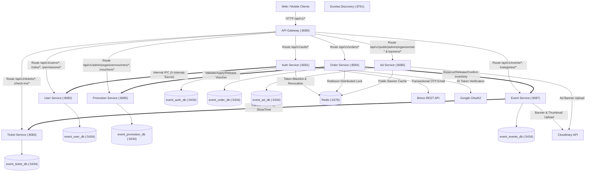

# Event & Festival Platform — Backend Microservices

[](https://openjdk.org/projects/jdk/21/)
[](https://spring.io/projects/spring-boot)
[](https://spring.io/projects/spring-cloud)
[](https://www.postgresql.org/)
[](https://redis.io/)
[](LICENSE)

An enterprise-grade, event-driven backend microservices platform designed for event & festival management, seating & inventory control, ticket distribution, promotional campaigns, and on-site check-in operations. Built on **Spring Boot 3.3**, **Spring Cloud 2023**, **PostgreSQL 16**, and **Redis 7** with strict adherence to Clean Architecture, Database-per-Service isolation, and stateless JWT security.

---

## 1. Key Capabilities by Service

### Edge & Infrastructure Services (`discovery-service`, `api-gateway`, `common-base`)
* **Service Registry & Discovery (`:8761`)**: Netflix Eureka server providing dynamic service registration, heartbeat monitoring, and client-side load balancing (`lb://`).
* **Unified API Gateway (`:8080`)**: Spring Cloud Gateway handling centralized routing, global CORS policies, and aggregated OpenAPI 3 / Swagger UI documentation across microservices.
* **Shared Kernel (`common-base`)**: Standardized response envelopes (`ApiResponse<T>`, `PageResponse<T>`), unified `ErrorCode` catalog, `BaseAuditableEntity`, and `GlobalExceptionHandler`.

### Identity & Account Security (`auth-service` — `:8081`)
* **Stateless Dual-Token Authentication & Reuse Detection**: HMAC-SHA256 JWT access tokens (with millisecond `iat_ms` precision) paired with `HttpOnly` SHA-256 hashed refresh tokens, automatic token rotation, replay attack detection (revoking all user sessions upon refresh token reuse), and Redis-backed single/all-device revocation (`/api/v1/auth/logout`, `/api/v1/auth/logout-all`).
* **Dynamic Security Policy & Brute-Force Lockout**: Admin-configurable security policy (`/api/v1/auth/security-policy`), automatic temporary account locking after $N$ failed login attempts, and early account unlock via 6-digit OTP (`/api/v1/auth/request-unlock`, `/api/v1/auth/unlock-account`).
* **Self-Service Password Recovery**: OTP-based password reset (`/api/v1/auth/forgot-password`, `/api/v1/auth/reset-password`) with 60-second anti-spam cooldown, maximum OTP attempt enforcement, password reuse prevention, and automatic session revocation upon password change.
* **Google OAuth2 Federation & Brevo Transactional Email**: One-tap Google ID Token verification (`/api/v1/auth/oauth2/google`) and asynchronous HTML OTP/verification email delivery via the Brevo REST API.

### User Profile, RBAC & Organizer Upgrade Workflow (`user-service` — `:8082`)
* **Self-Service Profile & Admin User Directory**: Profile inspection and updates (`/api/v1/users/me`), Vietnam phone number normalization (`+84`/`84` $\rightarrow$ `0`), cross-account phone uniqueness validation, XSS URL protection, and Admin paginated user search (`/api/v1/users`).
* **Role-Based Access Control (RBAC)**: Method-level authorization (`@PreAuthorize`) across 4 business roles (`ROLE_ADMIN`, `ROLE_ORGANIZER`, `ROLE_ATTENDEE`, `ROLE_STAFF`) with Role & Permission inspection (`/api/v1/roles`, `/api/v1/permissions`) and Admin role assignment (`/api/v1/users/{id}/roles`).
* **Organizer Upgrade Application & Admin Review**: Structured organizer application workflow (`/api/v1/users/me/organizer-application`) supporting `INDIVIDUAL`, `COMMUNITY`, and `BUSINESS` applicants with partial unique index protection against duplicate `PENDING` applications, `PESSIMISTIC_WRITE` row locking, self-approval prevention, and automatic upgrade to `ROLE_ORGANIZER` upon Admin approval (`/api/v1/users/organizer-applications/{id}/review`).

### Event Lifecycle, Seating & Atomic Inventory (`event-service` — `:8087`)
* **Category Management & Organizer Proposals (`/api/v1/categories`)**: Admin category CRUD, `ACTIVE`/`INACTIVE` status toggling, and organizer category proposal workflow (`/api/v1/categories/requests/**`) that automatically provisions active categories upon Admin approval.
* **End-to-End Event Lifecycle & Moderation (`/api/v1/events`)**: Draft event creation (`DRAFT`), editing, refund policy configuration (`/refund-policy`), submission for review (`PENDING_REVIEW`), Admin approval (`PUBLISHED`) or rejection (`REJECTED`), event cancellation (`/cancel` triggering batch ticket cancellation via Feign), and automated completion (`ENDED` via `/mark-ended`).
* **Showtimes, Ticket Tiers & Seat Map Engine**: Multi-showtime scheduling (`/show-times`), ticket tier management (`/ticket-types`) with automatic per-showtime inventory provisioning, seat sections (`/seat-sections`), bulk seat generation (`/seats`), and ticket-type-to-seat mapping (`/assign-ticket-type`).
* **Event Media Security**: Multipart banner/thumbnail uploads (`/media/banner`, `/media/thumbnail`) via Cloudinary or isolated local storage with magic-byte MIME verification, plus SSRF-safe external HTTPS media URL updates (`/media/urls`).
* **Public Event Discovery (`/api/v1/events/public`)**: Vietnamese accent-insensitive keyword search, multi-criteria filtering (category, slug, city, date window, min/max price), and detailed public event/showtime/seat-map views.
* **Atomic Internal Inventory Engine (`/internal/v1/events/**`)**: Constant-time `X-Internal-Secret` authentication, `PESSIMISTIC_WRITE` locking, and conditional atomic inventory transitions (`check-and-reserve`, `release`, `confirm`) alongside event snapshot retrieval.

### Distributed Order & Checkout Processing (`order-service` — `:8084`)
* **15-Minute Ticket Reservation & Order Management (`/api/v1/orders`)**: Order creation (`POST /api/v1/orders`), lookup by UUID (`/{id}`) or unique order code (`/code/{orderCode}`), and paginated customer order history (`/my-orders`).
* **Redisson Distributed Lock & Cross-Service Orchestration**: Coordinates high-concurrency ticket reservation using Redisson distributed locks (`RedissonClient`), atomic inventory reservation in `event-service`, and voucher discount calculation/application in `promotion-service`.

### Promotional Campaigns & Voucher Wallet (`promotion-service` — `:8085`)
* **Admin & Organizer Voucher Management (`/api/v1/admin/vouchers`, `/api/v1/organizer/vouchers`)**: Full CRUD and deactivation for platform-wide (Admin) and event-scoped (Organizer) promotional vouchers with MapStruct DTO mapping.
* **User Voucher Wallet (`/api/v1/vouchers/wallet`, `/api/v1/admin/vouchers/{id}/issue`)**: Attendee voucher wallet listing and Admin voucher issuance to specific users.
* **Internal Voucher Validation & Quota Engine (`/internal/v1/vouchers`)**: Internal IPC endpoints (`validate`, `apply`, `release`) guarded by `X-Internal-Secret` for order checkout integration.

### Ticket Issuance & Gate Check-In (`ticket-service` — `:8083`)
* **Ticket Issuance & Lifecycle (`/api/v1/tickets`, `/internal/v1/tickets`)**: Single and batch ticket issuance (`/issue`, `/issue-batch`), authenticated ticket lookup by ID (`/{id}`) or order ID (`/orders/{orderId}`), and batch ticket cancellation by showtimes (`/cancel-by-show-times`).
* **Gate Check-In Operations (`/api/v1/check-ins`)**: QR/ticket check-in processing (`POST /api/v1/check-ins`) and check-in history lookup by ticket ID (`/tickets/{ticketId}`) for `ROLE_STAFF`, `ROLE_ORGANIZER`, and `ROLE_ADMIN`.

### Advertising Campaigns & Banner Management (`ad-service` — `:8086`)
* **Public Banners & Position Pricing (`/api/v1/public/banners`, `/api/v1/public/ad-position-prices`)**: Redis-cached active promotional banners and ad placement position pricing.
* **Ad Packages, Position Surcharges & Banner Moderation (`/api/v1/admin/**`)**: Admin CRUD for ad packages (`/ad-packages`), position pricing (`/ad-position-prices`), banner management (`/banners`), Cloudinary banner upload (`/banners/upload`), and banner image approval (`/approve-image`).
* **Organizer Ad Campaigns & Settlement (`/api/v1/organizer/ad-campaigns`, `/internal/v1/ad-campaigns/{id}/settlement`)**: Organizer campaign registration with pricing snapshots, Admin campaign approval/rejection, and postpaid campaign fee settlement.

---

## 2. System Architecture



---

## 3. Services & Port Allocation

All microservices are configured with non-overlapping ports and isolated PostgreSQL databases on port `5434`:

| Module / Service | Port | Description | Database (`:5434`) |
| :--- | :---: | :--- | :--- |
| **`discovery-service`** | `8761` | Netflix Eureka Service Registry & Health Dashboard | N/A |
| **`api-gateway`** | `8080` | Unified Edge Gateway, Route Aggregation & Centralized Swagger UI | N/A |
| **`auth-service`** | `8081` | Registration, Login, Lockout/Unlock OTP, Password Reset, OAuth2, JWT & Redis Blacklist | `event_auth_db` |
| **`user-service`** | `8082` | User Profiles, RBAC (`Role`/`Permission`), Organizer Applications & Admin Review | `event_user_db` |
| **`ticket-service`** | `8083` | Ticket Issuance, Batch Showtime Cancellation & Gate Check-In Operations | `event_ticket_db` |
| **`order-service`** | `8084` | 15-Minute Ticket Reservation Orders, Redisson Distributed Lock & Voucher Checkout | `event_order_db` |
| **`promotion-service`** | `8085` | Admin/Organizer Vouchers, User Voucher Wallet & Internal Discount Calculation | `event_promotion_db` |
| **`ad-service`** | `8086` | Public Banners (Redis Cache), Ad Packages, Position Pricing & Organizer Ad Campaigns | `event_ad_db` |
| **`event-service`** | `8087` | Event Lifecycle, Categories/Proposals, Showtimes, Seat Maps, Media & Atomic Inventory | `event_events_db` |
| **`common-base`** | Library | Shared DTOs (`ApiResponse`, `PageResponse`), `ErrorCode`, `GlobalExceptionHandler` | Shared JAR |

---

## 4. Tech Stack

* **Language & Runtime**: Java 21 (LTS)
* **Framework**: Spring Boot 3.3.4, Spring Cloud 2023.0.3 (Gateway, Netflix Eureka, OpenFeign)
* **Security**: Spring Security 6.3 (`@EnableMethodSecurity`), JJWT (`io.jsonwebtoken 0.12.6`), BCrypt, Constant-Time Internal Secret Verification
* **Database, Migration & Mapping**: PostgreSQL 16, Spring Data JPA / Hibernate 6.5, Flyway 10, MapStruct `1.5.5.Final`
* **Distributed Locking & Caching**: Redis 7 (`spring-boot-starter-data-redis`, Redisson `3.34.0`)
* **External Integrations**: Brevo REST API (`https://api.brevo.com/v3`), Google API Client (`2.6.0`), Cloudinary
* **Documentation**: Springdoc OpenAPI `2.6.0`
* **Infrastructure**: Docker & Docker Compose (`postgres:16-alpine` on `:5434`, `redis:7-alpine` on `:6379`)

---

## 5. Getting Started

### Prerequisites
* **Java Development Kit (JDK)**: Version 21
* **Apache Maven**: Version 3.9+
* **Docker & Docker Compose**: For PostgreSQL (`:5434`) and Redis (`:6379`) containers

### 1. Clone & Setup Environment
```bash
git clone https://github.com/TruongHai-SE/event-platform-backend.git
cd event-platform-backend

# Copy environment template
cp .env.example .env
```
Configure the required credentials in `.env` (`BREVO_API_KEY`, `MAIL_FROM`, `GOOGLE_CLIENT_ID`, `TOKEN_SECRET_KEY`, `INTERNAL_API_SECRET`, `CLOUDINARY_*`).

### 2. Start PostgreSQL & Redis Infrastructure
```bash
docker compose up -d
```
Starts `event-platform-postgres` (`:5434`, initializing isolated service databases) and `event-platform-redis` (`:6379`).

### 3. Build & Run Automated Tests
```bash
mvn clean test
```

### 4. Launch Services (Recommended Order)
1. **Discovery Service**: `DiscoveryServiceApplication` (`:8761`)
2. **API Gateway**: `ApiGatewayApplication` (`:8080`)
3. **User Service**: `UserServiceApplication` (`:8082`)
4. **Auth Service**: `AuthServiceApplication` (`:8081`)
5. **Event Service**: `EventServiceApplication` (`:8087`)
6. **Ticket Service**: `TicketServiceApplication` (`:8083`)
7. **Promotion Service**: `PromotionServiceApplication` (`:8085`)
8. **Order Service**: `OrderServiceApplication` (`:8084`)
9. **Ad Service**: `AdServiceApplication` (`:8086`)

---

## 6. API Documentation

Interactive OpenAPI 3 documentation is available at:

* **Swagger UI Portal (API Gateway)**: [`http://localhost:8080/swagger-ui.html`](http://localhost:8080/swagger-ui.html)
* **Eureka Registry Dashboard**: [`http://localhost:8761`](http://localhost:8761)

---

## 7. Role-Based Access Control (RBAC)

The platform enforces four standard business roles across all microservices:

| Role | Target Persona | Scope & Permissions |
| :--- | :--- | :--- |
| `ROLE_ADMIN` | System Administrator | Full access: user & role management, security policy, organizer application review, category & event approval, platform vouchers, ad packages & banner moderation |
| `ROLE_ORGANIZER` | Event Organizer | Create & manage events, propose categories, configure showtimes/ticket tiers/seat maps, manage organizer vouchers, and register ad campaigns (granted upon application approval) |
| `ROLE_ATTENDEE` | Ticket Buyer / Attendee | Default role upon registration; discover public events, submit organizer upgrade application, collect vouchers in wallet, reserve orders & view tickets |
| `ROLE_STAFF` | On-site Staff | Perform gate check-in (`POST /api/v1/check-ins`) and verify attendee ticket check-in status |

---

## 8. License & Contributors

Developed by **Group 6 — MSS301**.  
Licensed under the [MIT License](LICENSE).
