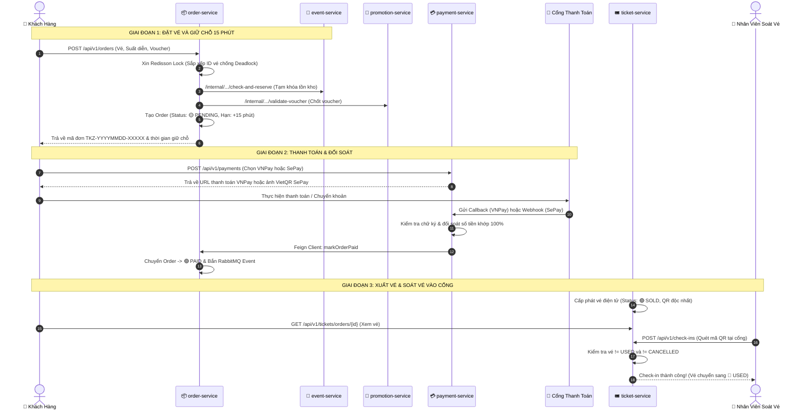
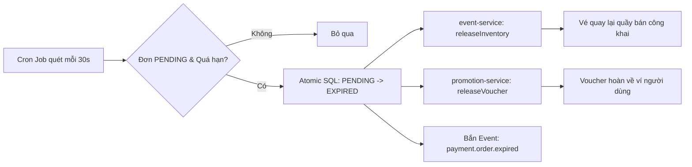

# Kiến Trúc Nghiệp Vụ & Kỹ Thuật: Order — Ticket — Payment

> 📌 **Tổng Quan Hệ Thống**  
> • **Dự án**: Event & Festival Management Platform (Tikzy)  
> • **Phân hệ**: Đơn hàng (`order-service`), Vé & Soát vé (`ticket-service`), Thanh toán (`payment-service`)  
> • **Hạ tầng**: PostgreSQL 16 • Redis 7 (Redisson) • RabbitMQ 3.13 • VNPay • SePay VietQR  
> • **Tài liệu tham chiếu**: [README.md](file:///Users/ttcenter/workplace/mss301/code/event-platform-backend/README.md) • [DATABASE.md](file:///Users/ttcenter/workplace/mss301/code/event-platform-backend/DATABASE.md)

---

## 1. Phân Vai Microservices & Mã Nguồn

Hệ thống tuân thủ nghiêm ngặt mô hình **Database-per-Service** (mỗi dịch vụ quản lý DB độc lập, không truy cập chéo).

### 1.1. Tổng Quan 3 Dịch Vụ Cốt Lõi

#### 📦 1. Order Service
* **Cổng mạng & Database**: Port `:8084` • Database `event_order_db`
* **Trách nhiệm chính**:
  - Điều phối chu trình đặt vé và giữ chỗ trong **15 phút**.
  - Snapshot đơn giá niêm yết từ sự kiện, chốt mã giảm giá voucher.
  - Tự động quét và giải phóng tồn kho khi đơn hàng hết hạn thanh toán.

#### 💳 2. Payment Service
* **Cổng mạng & Database**: Port `:8088` • Database `event_payment_db`
* **Trách nhiệm chính**:
  - Khởi tạo phiên thanh toán qua **VNPay** và **SePay** (VietQR).
  - Cho phép thử lại hoặc đổi cổng thanh toán linh hoạt trong 15 phút.
  - Nhận và xác thực callback/webhook, đối soát tiền và kích hoạt hoàn tiền.

#### 🎟️ 3. Ticket Service
* **Cổng mạng & Database**: Port `:8083` • Database `event_ticket_db`
* **Trách nhiệm chính**:
  - Phát hành vé điện tử kèm mã QR độc nhất sau khi đơn hàng `PAID`.
  - Cung cấp API soát vé tại cổng vào sự kiện (Check-in) cho Staff.
  - Kiểm soát nghiêm ngặt chống check-in 2 lần (Double Check-in).

---

### 1.2. Danh Sách File Nguồn Trọng Tâm

#### 📦 Phân Hệ Đơn Hàng (`order-service`)
* [`OrderController.java`](file:///Users/ttcenter/workplace/mss301/code/event-platform-backend/order-service/src/main/java/vn/eventplatform/order/controller/OrderController.java) — REST API tạo đơn, xem chi tiết, đếm ngược và đổi cổng thanh toán.
* [`OrderServiceImpl.java`](file:///Users/ttcenter/workplace/mss301/code/event-platform-backend/order-service/src/main/java/vn/eventplatform/order/service/OrderServiceImpl.java) — Logic nghiệp vụ tạo đơn, snapshot giá vé, áp dụng voucher, hủy đơn và hết hạn.
* [`RedissonInventoryLockService.java`](file:///Users/ttcenter/workplace/mss301/code/event-platform-backend/order-service/src/main/java/vn/eventplatform/order/lock/RedissonInventoryLockService.java) — Khóa phân tán Redis chống Deadlock và chống bán vượt (Overselling).
* [`OrderExpirationScheduler.java`](file:///Users/ttcenter/workplace/mss301/code/event-platform-backend/order-service/src/main/java/vn/eventplatform/order/scheduler/OrderExpirationScheduler.java) — Cron Job chạy nền mỗi 30s tự động thu hồi vé quá hạn 15 phút.

#### 💳 Phân Hệ Thanh Toán (`payment-service`)
* [`PaymentController.java`](file:///Users/ttcenter/workplace/mss301/code/event-platform-backend/payment-service/src/main/java/vn/eventplatform/payment/controller/PaymentController.java) — API tạo phiên thanh toán, nhận callback VNPay và webhook SePay.
* [`PaymentServiceImpl.java`](file:///Users/ttcenter/workplace/mss301/code/event-platform-backend/payment-service/src/main/java/vn/eventplatform/payment/service/PaymentServiceImpl.java) — Điều phối luồng thanh toán, đối soát số tiền, cập nhật đơn `PAID` và hoàn tiền.
* [`VnPayPaymentStrategy.java`](file:///Users/ttcenter/workplace/mss301/code/event-platform-backend/payment-service/src/main/java/vn/eventplatform/payment/payment/vnpay/VnPayPaymentStrategy.java) — Tạo URL thanh toán VNPay và xác thực chữ ký số HMAC-SHA512.
* [`SePayPaymentStrategy.java`](file:///Users/ttcenter/workplace/mss301/code/event-platform-backend/payment-service/src/main/java/vn/eventplatform/payment/payment/sepay/SePayPaymentStrategy.java) — Tạo URL ảnh mã VietQR Napas (MBBank) và bóc tách mã đơn chuyển khoản.

#### 🎟️ Phân Hệ Vé & Soát Vé (`ticket-service`)
* [`TicketController.java`](file:///Users/ttcenter/workplace/mss301/code/event-platform-backend/ticket-service/src/main/java/vn/eventplatform/ticket/controller/TicketController.java) — API tra cứu vé của người dùng theo mã đơn hàng.
* [`TicketServiceImpl.java`](file:///Users/ttcenter/workplace/mss301/code/event-platform-backend/ticket-service/src/main/java/vn/eventplatform/ticket/service/TicketServiceImpl.java) — Cấp phát vé sau khi thanh toán, khóa vé hàng loạt khi show bị hủy.
* [`CheckInController.java`](file:///Users/ttcenter/workplace/mss301/code/event-platform-backend/ticket-service/src/main/java/vn/eventplatform/ticket/controller/CheckInController.java) — API dành riêng cho Staff quét mã QR soát vé tại cửa.
* [`CheckInServiceImpl.java`](file:///Users/ttcenter/workplace/mss301/code/event-platform-backend/ticket-service/src/main/java/vn/eventplatform/ticket/service/CheckInServiceImpl.java) — Kiểm tra tính hợp lệ của vé, ngăn chặn check-in 2 lần.

---

## 2. Sơ Đồ Luồng Hoạt Động (End-to-End Workflow)



---

## 3. Quy Trình Nghiệp Vụ Chi Tiết

### 3.1. Luồng Tạo Đơn Hàng & Giữ Chỗ (15 Phút)

* **API Tiếp nhận**: `POST /api/v1/orders`
* **Trạng thái ban đầu**: 🟡 `PENDING`
* **Thời gian giữ chỗ**: `expiresAt = Thời điểm tạo + 15 phút`

```
┌────────────────────────────────────────────────────────────────────────┐
│ 8 BƯỚC XỬ LÝ NGUYÊN TỬ TRONG OrderServiceImpl.doCreateOrder            │
├────────────────────────────────────────────────────────────────────────┤
│ Bước 1. Kiểm tra dữ liệu: Số lượng vé >= 1, cấm chọn trùng hạng vé     │
│ Bước 2. Xin khóa phân tán: Redisson Lock theo showTimeId + ticketTypes │
│ Bước 3. Giữ tồn kho: Gọi event-service khóa bi quan (Pessimistic Lock) │
│ Bước 4. Snapshot đơn giá: Lấy giá gốc từ DB, KHÔNG tin giá Client      │
│ Bước 5. Validate Voucher: Gọi promotion-service tính mức giảm chính thức│
│ Bước 6. Sinh mã đơn: Chuẩn định dạng TKZ-YYYYMMDD-XXXXX                │
│ Bước 7. Lưu đơn hàng: Lưu Order và OrderItems đã chốt snapshot giá     │
│ Bước 8. Bắn sự kiện: Gửi event 'payment.order.created' sang RabbitMQ   │
└────────────────────────────────────────────────────────────────────────┘
```

> [!IMPORTANT]
> **Quy Tắc Snapshot Giá Vé & Voucher:**
> - Giá vé được đọc trực tiếp từ bảng `ticket_types` thông qua `event-service`. Giá vé client gửi lên bị bỏ qua hoàn toàn để triệt tiêu lỗ hổng can thiệp giá giao diện.
> - Số tiền giảm giá `discountAmount` không vượt quá tổng phụ `subtotal`. Số tiền thực trả tối thiểu là `0 VNĐ`.

---

### 3.2. Luồng Khởi Tạo & Đổi Cổng Thanh Toán

Hệ thống hỗ trợ 2 cổng thanh toán với đặc thù kỹ thuật riêng biệt:

#### 🏦 Cổng 1: VNPay (Cổng thanh toán trực tuyến)
* **Phương thức phản hồi**: Đường dẫn chuyển hướng trình duyệt (`paymentUrl`).
* **Thời hạn phiên**: Tối đa 15 phút (đồng bộ theo hạn còn lại của đơn hàng).
* **Cơ chế bảo mật & Kỹ thuật**:
  - Băm chữ ký số **HMAC-SHA512** với danh sách tham số sắp xếp A-Z.
  - Giá trị đơn hàng gửi sang nhân 100 (`vnp_Amount`).
  - Đối soát mã phản hồi thành công `vnp_ResponseCode == "00"`.

#### 📱 Cổng 2: SePay (VietQR chuyển khoản ngân hàng)
* **Phương thức phản hồi**: Mã QR chuyển khoản nhanh Napas (`qrCode`).
* **Thời hạn phiên**: Theo hạn giữ chỗ 15 phút của đơn hàng.
* **Cơ chế bảo mật & Kỹ thuật**:
  - Tạo URL ảnh VietQR tự động qua ngân hàng MBBank.
  - Cú pháp chuyển khoản chuẩn hóa bỏ dấu `-` (ví dụ: `TKZ20261018ABC12`).
  - Xác thực webhook bằng SePay API Key qua header HTTP.

> [!TIP]
> **Quy Tắc Đổi Cổng Thanh Toán (Retry Payment):**
> Khi khách hàng muốn đổi từ VNPay sang SePay (hoặc ngược lại) trong hạn 15 phút:
> 1. Hệ thống kiểm tra đơn hàng vẫn đang ở trạng thái 🟡 `PENDING` và chưa quá hạn.
> 2. Tự động chuyển tất cả bản ghi payment 🟡 `PENDING` cũ của đơn hàng sang ⚪ `CANCELLED`.
> 3. Tạo một bản ghi payment mới cho phương thức vừa chọn.

---

### 3.3. Luồng Quá Hạn & Tự Động Thu Hồi Tồn Kho

Khi đơn hàng vượt quá 15 phút mà chưa thanh toán:



> [!NOTE]
> **Tính Idempotent Khi Thu Hồi Đơn:**
> Sử dụng câu lệnh cập nhật có điều kiện:
> ```sql
> UPDATE orders SET status = 'EXPIRED', updated_at = NOW() 
> WHERE id = :orderId AND status = 'PENDING';
> ```
> Chỉ duy nhất luồng nào cập nhật thành công (số dòng > 0) mới được quyền gọi nhả kho và nhả voucher. Luồng chạy sau thấy 0 dòng sẽ tự động dừng, chống việc nhả kho 2 lần.

---

### 3.4. Luồng Xuất Vé & Soát Vé Tại Cổng Sự Kiện

```
            ┌──────────────────────┐
            │   Đơn Hàng Đã PAID   │
            └──────────┬───────────┘
                       │
                       ▼
            ┌──────────────────────┐
            │  Trạng thái: 🟢 SOLD │  Vé hợp lệ, mang mã QR độc nhất
            └──────────┬───────────┘
                       │
         ┌─────────────┴─────────────┐
         ▼                           ▼
[Khách Quét Mã Vào Cổng]    [Sự Kiện Bị Hủy / Hoàn Tiền]
         │                           │
         ▼                           ▼
┌──────────────────────┐    ┌──────────────────────┐
│  Trạng thái: 🔵 USED │    │Trạng thái: 🔴CANCELLED│
└──────────────────────┘    └──────────────────────┘
(Vào cổng thành công)        (Từ chối vào cổng)
```

> [!WARNING]
> **Quy Tắc Soát Vé Chống Gian Lận (Gate Check-In):**
> Khi nhân viên (`ROLE_STAFF`) quét mã QR của khách:
> 1. Nếu vé ở trạng thái 🔴 `CANCELLED` → **Từ chối ngay lập tức** (vé đã bị khóa do hủy show hoặc đã hoàn tiền).
> 2. Nếu vé ở trạng thái 🔵 `USED` hoặc đã có lịch sử check-in → **Cảnh báo gian lận** (vé đã vào cổng trước đó, chống Double Check-in).
> 3. Nếu hợp lệ → Chuyển vé sang 🔵 `USED`, ghi nhận thời gian, staffId và phương thức soát vé.

---

## 4. Các Giải Pháp Kỹ Thuật Then Chốt

### 4.1. Chống Bán Vượt & Khóa Phân Tán (Redisson MultiLock)

* **Key khóa phân tán**: `lock:inventory:showtime:{showTimeId}:ticket-type:{ticketTypeId}`
* **Cơ chế chống Deadlock ABBA**:
  Trước khi gọi `RedissonMultiLock`, danh sách `ticketTypeIds` bắt buộc phải được lọc bỏ trùng lặp và **sắp xếp theo thứ tự bảng chữ cái** (`sorted()`). Điều này đảm bảo mọi luồng đồng thời luôn xin khóa theo cùng một thứ tự nhất quán, triệt tiêu hoàn toàn nguy cơ deadlock.
* **Tầng Database (Khóa bi quan)**:
  `event-service` thực hiện `SELECT ... FOR UPDATE` và câu lệnh UPDATE có điều kiện tồn kho khả dụng:
  ```sql
  UPDATE show_time_ticket_inventories 
  SET reserved_quantity = reserved_quantity + :qty 
  WHERE id = :invId AND (total_quantity - reserved_quantity - sold_quantity) >= :qty;
  ```

---

### 4.2. Bảo Mật Cổng Thanh Toán & Xác Thực Nội Bộ

* 🛡️ **Chữ ký VNPay (HMAC-SHA512)**:
  - Sắp xếp toàn bộ tham số `vnp_*` theo thứ tự chữ cái A-Z, mã hóa URL chuẩn ASCII rồi băm với Secret Key để chống sửa đổi dữ liệu.
* 🔑 **Webhook SePay (API Key + Regex)**:
  - Kiểm tra Bearer/ApiKey ở header HTTP; bóc tách mã đơn bằng regex `(?i)TKZ[A-Z0-9-]{6,25}` và chuẩn hóa bỏ dấu `-`.
* ⏱️ **Xác thực nội bộ (Constant-Time Compare)**:
  - Dùng `MessageDigest.isEqual` so sánh secret giữa các microservices, chống tấn công dò khóa qua độ trễ thời gian (Timing Attacks).
* 🔒 **Phân quyền truy cập IDOR**:
  - Người dùng thông thường chỉ được xem đơn hàng của chính mình (`userId == currentUserId`). Quyền xem tất cả đơn hàng chỉ dành cho `ROLE_ADMIN` hoặc `ROLE_STAFF`.

---

### 4.3. Ràng Buộc Cơ Sở Dữ Liệu Chống Trùng Lặp (PostgreSQL)

```sql
-- 1. Chống ghi nhận 2 giao dịch thanh toán thành công cho cùng 1 đơn hàng
CREATE UNIQUE INDEX uq_payments_one_settled_payment_per_order
    ON payments (order_id)
    WHERE status IN ('SUCCESS', 'REFUNDED');

-- 2. Chống ghi nhận trùng mã giao dịch từ phía ngân hàng
CREATE UNIQUE INDEX uq_payments_method_transaction_id
    ON payments (method, transaction_id)
    WHERE transaction_id IS NOT NULL;

-- 3. Chống tạo yêu cầu hoàn tiền lặp lại cho cùng 1 giao dịch
CREATE UNIQUE INDEX uq_refund_logs_idempotency_key
    ON refund_logs (idempotency_key)
    WHERE idempotency_key IS NOT NULL;

-- 4. Chống soát vé hai lần ở mức cơ sở dữ liệu
CREATE UNIQUE INDEX uq_check_ins_ticket_id 
    ON check_ins (ticket_id);
```

---

### 4.4. Kiến Trúc Hướng Sự Kiện (RabbitMQ AMQP)

```
                 Topic Exchange: event.platform.exchange
                                │
    ┌───────────────────────────┼───────────────────────────┐
    │ payment.order.created     │ payment.order.paid        │ payment.order.expired
    ▼                           ▼                           ▼
┌──────────────┐          ┌──────────────┐          ┌──────────────┐
│  Gửi Email   │          │   Xuất Vé    │          │  Giải Phóng  │
│  Tạo Đơn     │          │  Điện Tử     │          │  Tồn Kho &   │
│              │          │  (Tickets)   │          │  Voucher     │
└──────────────┘          └──────────────┘          └──────────────┘
    │                           │                           │
    └───────────────────────────┼───────────────────────────┘
                                │ (Thất bại sau 3 lần retry lũy tiến)
                                ▼
                 Direct Exchange: event.platform.dlx
                                │
                                ▼
                Hàng đợi lỗi: *.dlq (Dead Letter Queue)
```

---

## 5. Bảng Tra Cứu Trạng Thái Thực Thể

### 5.1. Vòng Đời Đơn Hàng (Order Status)

* 🟡 **`PENDING` (Chờ xử lý)**
  - *Ý nghĩa*: Đơn hàng mới tạo, đang giữ chỗ vé trong 15 phút chờ thanh toán.
  - *Chuyển tiếp sang*: 🟢 `PAID` • 🔴 `CANCELLED` • ⚪ `EXPIRED`

* 🟢 **`PAID` (Thành công)**
  - *Ý nghĩa*: Đã đối soát thanh toán thành công từ cổng VNPay hoặc SePay.
  - *Chuyển tiếp sang*: 🟣 `REFUNDED`

* ⚪ **`EXPIRED` (Quá hạn giữ chỗ)**
  - *Ý nghĩa*: Quá 15 phút chưa thanh toán, vé và voucher đã tự động nhả lại kho.
  - *Chuyển tiếp*: *(Trạng thái kết thúc)*

* 🔴 **`CANCELLED` (Đã hủy)**
  - *Ý nghĩa*: Người mua chủ động bấm hủy đơn khi còn đang ở trạng thái PENDING.
  - *Chuyển tiếp*: *(Trạng thái kết thúc)*

* 🟣 **`REFUNDED` (Đã hoàn tiền)**
  - *Ý nghĩa*: Đơn hàng đã được xử lý hoàn tiền đầy đủ cho người mua.
  - *Chuyển tiếp*: *(Trạng thái kết thúc)*

---

### 5.2. Vòng Đời Giao Dịch Thanh Toán (Payment Status)

* 🟡 **`PENDING` (Đang chờ)**
  - *Ý nghĩa*: Phiên thanh toán đang chờ khách quét mã VietQR hoặc chuyển tiền qua VNPay.
  - *Chuyển tiếp sang*: 🟢 `SUCCESS` • 🔴 `FAILED` • ⚪ `CANCELLED`

* 🟢 **`SUCCESS` (Khớp tiền)**
  - *Ý nghĩa*: Tiền đã vào tài khoản ngân hàng, chữ ký số hoặc webhook hợp lệ 100%.
  - *Chuyển tiếp sang*: 🟣 `REFUNDED`

* 🔴 **`FAILED` (Thất bại)**
  - *Ý nghĩa*: Khách hủy thanh toán, sai chữ ký số, hoặc chuyển thiếu tiền.
  - *Chuyển tiếp*: *(Trạng thái kết thúc)*

* ⚪ **`CANCELLED` (Bị hủy)**
  - *Ý nghĩa*: Bị hủy do khách hàng bấm đổi sang cổng thanh toán khác.
  - *Chuyển tiếp*: *(Trạng thái kết thúc)*

* 🟣 **`REFUNDED` (Hoàn tiền)**
  - *Ý nghĩa*: Tiền đã được xử lý hoàn trả lại cho người mua.
  - *Chuyển tiếp*: *(Trạng thái kết thúc)*

---

### 5.3. Vòng Đời Vé Điện Tử (Ticket Status)

* 🟢 **`SOLD` (Đã bán)**
  - *Ý nghĩa*: Vé đã phát hành sau khi đơn hàng chuyển sang PAID thành công.
  - *Chuyển tiếp sang*: 🔵 `USED` • 🔴 `CANCELLED`

* 🔵 **`USED` (Đã sử dụng)**
  - *Ý nghĩa*: Khách hàng đã quét mã QR qua cổng soát vé thành công.
  - *Chuyển tiếp*: *(Trạng thái kết thúc — Cấm dùng lại, chống Double Check-in)*

* 🔴 **`CANCELLED` (Đã khóa)**
  - *Ý nghĩa*: Vé bị khóa do sự kiện bị hủy hoặc đơn hàng đã được hoàn tiền.
  - *Chuyển tiếp*: *(Trạng thái kết thúc — Hệ thống từ chối vào cổng)*
